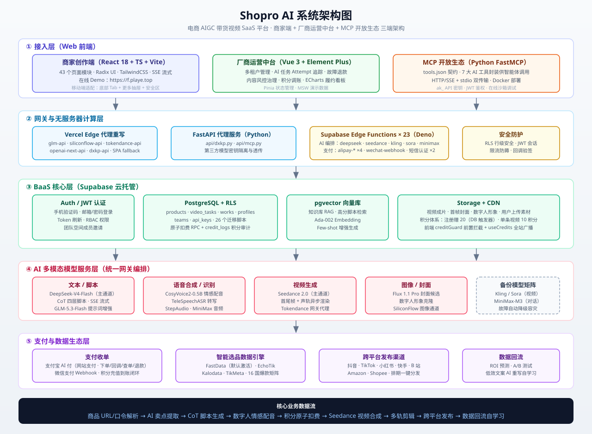
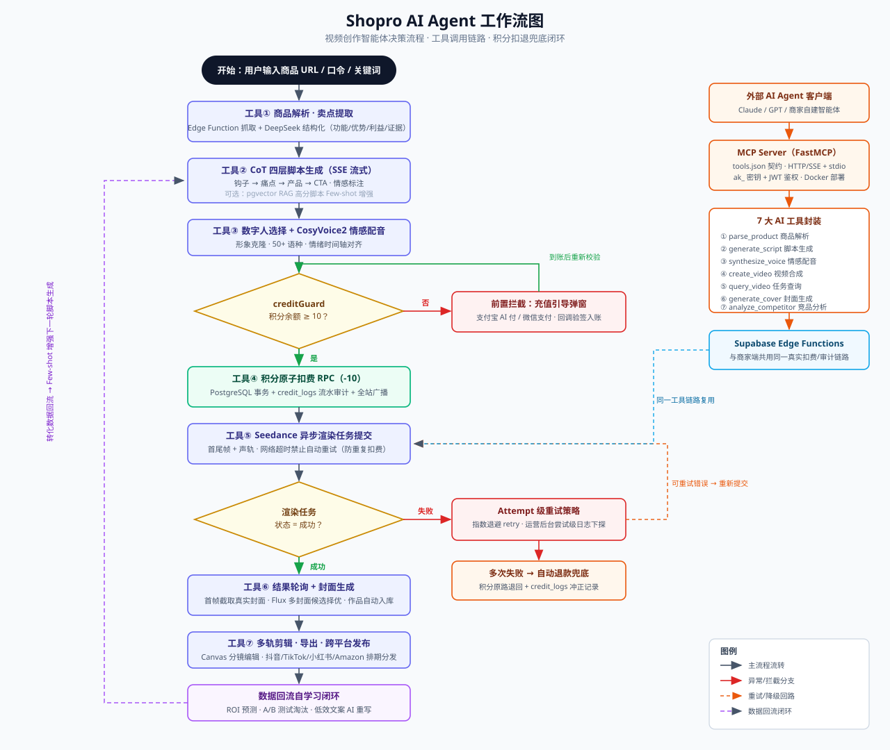

# 🛒 Shopro AI -跨境电商AIGC带货视频创作平台

<p align="center">
  
  
  
  
  
  
  
  
  
  
  
</p>

---

## 🧭 评委快速导航（5 分钟核验）

| 顺序 | 材料 | 入口 | 说明 |
|---|---|---|---|
| 1 | 在线体验 | <https://f.playe.top> | 注册赠积分 → 商品解析 → 脚本 → 视频 → 扣费 |
| 2 | 区域赛自评 | [区域赛评分.md](./区域赛评分.md) | 五维评分、证据台账、整改清单 |
| 3 | 码道使用证据 | [docs/codearts/](./docs/codearts/README.md) | 全流程证据、Prompt 台账、排错记录、截图清单 |
| 4 | 架构与测试 | [系统架构与测试汇总](./docs/doc/系统架构与测试汇总.md) | 五层架构图、Agent 工作流图、23 条用例 |
| 5 | 华为云接入 | [华为云接入方案](./docs/华为云接入方案.md) | OBS / CodeArts Pipeline / CES 实施与验收 |
| 6 | 演示兜底 | [演示与兜底方案](./docs/演示与兜底方案.md) | 8 分钟脚本与异常切换 |
| 7 | 变更记录 | [CHANGELOG.md](./CHANGELOG.md) | 比赛周期关键新增与修复 |
| 8 | 一键复现 | `pnpm install && pnpm dev`；`pnpm test` | 契约自检 9 项，零新增依赖 |

---

## 🤖 码道（CodeArts Agent）在项目开发中的应用

本项目的主要开发与治理工作均在**码道（华为云 CodeArts Agent）**工程环境中完成。码道不只用于生成代码片段，而是贯穿环境搭建、功能生成、调试排错、文档产出与质量整改五个阶段；下列结论均可在仓库内找到对应文件、提交或可执行命令。

### 一、五阶段应用

| 阶段 | 码道承担的工作 | 代表产物 | 可核验方式 |
|---|---|---|---|
| 环境搭建 | 工程初始化、配置生成、规范落地 | `package.json`、`vite.config.ts`、`tsconfig.*`、`.rules/`、`.codeartsdoer/` | `pnpm install && pnpm dev` |
| 功能生成 | 页面/组件/Edge Function/SQL 生成与契约补齐 | `src/pages`（43）、`src/components`（74）、`supabase/functions`（22 + `_shared`）、`migrations`（29） | 对照提交历史与页面清单 |
| 调试排错 | 报错定位、探针脚本、修复与回归 | `scratch/`（17 个探针）、`docs/codearts/04-调试排错记录.md` | 按记录中的 commit 复现 |
| 文档产出 | README、架构说明、测试用例、开发规范 | `README.md`、`docs/doc/TEST_CASES.md`、`docs/技术开发规范.md` | 按首次提交时间追溯 |
| 质量整改 | 评分分析、密钥治理、口径统一、契约测试与 CI | `区域赛评分.md`、`b50de9c`、`35101de`、`scripts/contracts.mjs` | `pnpm test`（9 项契约自检） |

### 二、协作方法（可复用）

1. **契约先行**：先定 `ApiResponse<T>`、权限码、状态枚举与错误码，再让码道写实现，避免"生成得快但接不上"。
2. **规则沉淀**：把每次纠偏写入 `AGENTS.md`、`.agents/rules/`、`.rules/*.yml`，让后续生成自动遵守，而不是重复口头约束。
3. **验收闭环**：要求码道给出可执行命令与结果（`pnpm build`、`pnpm test`、探针脚本），不以"看起来正确"结案。
4. **人工守红线**：资金扣减、退款、支付回调、RBAC、历史迁移五类改动必须人工评审并留日志。
5. **证据随做随存**：任务结束即登记 Prompt、产物与人工修改点，避免赛后补证。

### 三、真实性说明与不足

- **可核验范围**：2026-06-15 起的代码、SQL、文档与 173 次提交均可追溯；2026-10-01 后 29 次提交覆盖支付、后台、兑换码与安全整改。
- **历史边界**：2026-11-20 之前的逐次会话未留存导出记录，因此 `docs/codearts/05-文档生成记录.md` 中相关条目标注"待确认"，不做扩大归因；2026-11-20 起的评分分析、证据链、密钥治理、契约测试均有当次记录与提交。
- **已知不足**：早期未建立会话台账，导致赛后证据补录成本高；该问题已通过 `docs/codearts/` 的登记规范纠正。
- **不冒充真实能力**：模拟/降级分支在 `CURRENT_STATE.md` 中显式标记 `simulated` / `degraded`，演示与文档均不将其表述为真实调用。

### 四、证据入口

- 使用总览与核验路径：[docs/codearts/README.md](./docs/codearts/README.md)
- 五阶段证据映射：[02-全流程证据.md](./docs/codearts/02-全流程证据.md)
- Prompt 模板与台账：[03-prompt-台账.md](./docs/codearts/03-prompt-台账.md)
- 模块参与地图：[06-AI参与模块地图.md](./docs/codearts/06-AI参与模块地图.md)
- 截图清单与拍摄规范：[docs/codearts/screenshots/README.md](./docs/codearts/screenshots/README.md)

> 说明：码道使用披露同时记录于 `mcp/AI_DISCLOSURE.md` 第 5 节；该文件第 1 节的 Antigravity 为历史阶段工具，两者并列记录、互不替代。

---

## 💎 项目简介


**Shopro-AI 电商 AIGC 带货视频系统** 是一款面向国内外电商商家（如抖音、TikTok、小红书、Amazon、Shopee 等）的商业化 SaaS 平台。该系统通过深度融合先进的多模态大模型与全链路智能工作流，解决商家在短视频营销中面临的“文案撰写难、数字人/外籍演员贵、剪辑成本高、多语言本地化差、跨平台发布繁琐”等核心痛点。

系统构建了**商家端创作系统（C端/B端） + 厂商运营后台管理中台（Shopro-backend）** 的双端企业级解耦架构：
1. **商家创作端**：支持从「商品信息输入/URL 卖点提取 ➔ AI 智能脚本生成 ➔ 数字人选择与克隆 ➔ 多语言智能翻译 ➔ 分镜编辑 ➔ 素材混剪 ➔ 视频异步合成 ➔ 真实积分扣除与日志审计 ➔ 多平台一键发布与数据回流」的完整商业闭环，将传统的五人工作流压缩为“一人 + AI”，帮助商家以极低成本高速量产高转化的爆款短视频。
2. **厂商运营端**：提供企业级多租户 SaaS 运维中台，覆盖运营总览、算力积分调账、AI 工作流 Attempt 尝试级追踪与退款、内容风控证据链审计、订单与套餐版本快照及 MSW 零成本演示重置。

### ⚡ 核心价值与特色
*   **极致降本**：无需聘请外籍主播与剪辑师，注册送 50 初始积分，生成单条视频消耗 10 积分（10 积分 = 1 元），综合成本降至不足 1 元。
*   **极致增效**：从商品 URL 到生成多语种情感数字人口播视频仅需 3-5 分钟。
*   **转化导向**：引入营销学“说服框架”，对文案进行 CoT 分层打标签，自动映射数字人情绪。
*   **数据驱动**：集成 ROI 预测、A/B 分镜测试及投放数据回流闭环，越用越聪明。
*   **全自适应体验**：高精度的暗色/浅色玻璃态 UI，支持移动端和桌面端无缝响应。

---

## 🛠️ 技术栈

### 🌐 前端技术栈

| 分类 | 技术/依赖 | 版本/说明 | 用途 |
|---|---|---:|---|
| 核心框架 | React / Vue | 18.3.1 / 3.5.13 | 商家创作端 (React 18) 与 厂商运营后台 (Vue 3) |
| 开发语言 | TypeScript | 5.7.2 | 全链路强类型约束，提升工程可维护性 |
| 构建工具 | Vite | 6.0.7 / 5.4.1 | 极速热更新，生产资源打包优化与 Manual Chunks 分包 |
| 路由管理 | react-router-dom / Vue Router | 6.26.2 / 4.5.0 | 单页路由、受保护路由及 RBAC 权限路由守卫 |
| 状态/异步 | @tanstack/react-query / Pinia | 5.56.2 / 2.3.0 | 异步数据缓存、全局 Auth 会话与乐观更新 |
| UI 组件 | Radix UI + Element Plus | 基础组件 / 2.9.1 | 商家端组件与厂商后台企业级表格/表单/仪表盘 |
| 样式系统 | Tailwind CSS / Vanilla CSS | 3.4.11 / CSS3 | 原子化布局、高精度玻璃态与后台全局主题覆盖 |
| 动画与图表 | framer-motion / Recharts / ECharts | 12.4.10 / 5.6.0 | 页面动效、商家端流量看板与厂商履算趋势折线图/环形图 |
| API 模拟 | MSW (Mock Service Worker) | 2.7.0 | 厂商后台 Service Worker 请求拦截与浏览器端数据持久化 |
| 代码质量 | Biome / tsgo | 2.4.5 / 0.0.1 | 极速 Lint、格式化及预构建类型检查 |

### ⚙️ 后端与数据服务

| 分类 | 技术/服务 | 说明 | 项目中的作用 |
|---|---|---|---|
| 云服务 BaaS | Supabase | Auth、DB、Storage、Edge Functions (22个微函数) | 商家端全栈后端云服务托管 |
| 厂商后端标准 | Spring Boot | 3.x REST Server | 厂商后台 REST API (`/api/admin/**`) 生产接入标准 |
| 数据库 | PostgreSQL | 由 Supabase 托管，29 个增量迁移脚本 | RLS 物理数据隔离，pgvector 向量模糊搜索 |
| 兑换码核销 | coupons + SECURITY DEFINER RPC | `00028` 建表与核销函数、`00029` 补充 50 面积券 | 事务内完成校验、计数与入账，客户端零写权限 |
| 账户认证 | Supabase Auth / JWT | 邮箱/手机验证码登录与 JWT 会话 | 商家端与厂商后台 RBAC 权限校验与 Token 刷新 |
| 边缘计算 | Supabase Edge Functions | Deno 运行时 (22 个微服务) | AI 编排、双轨支付闭环、竞品抓取、团队协作接口 |
| 实时流式 | SSE + eventsource-parser | 前端 `src/lib/sse.ts` 封装 | 实现打字机流式（SSE）文本响应解析 |
| 积分流水 | 原子扣费 RPC + `credit_logs` | `supabase/schema.sql` + `useCredits.ts` | 真实扣减积分余额、排他锁防并发扣费、全站广播审计 |
| 支付体系 | 支付宝 AI 付 + 微信支付 | 网站支付 / WAP / Webhook 回调验签 | 完整的商业充值与履约保障，公私钥签名与回调验签 |
| AI 代理网关 | Python / FastAPI | Vercel Serverless (`/api/dxkp`, `/api/mcp`) | 第三方多模型 API 密钥物理隔离透传与 MCP 契约传输 |
| 开放生态 | MCP (FastMCP) | Python FastMCP，7 大工具契约封装 | 外部智能体（Claude / GPT）标准化调用视频创作全流程 |
| 统一 API 契约 | `ApiResponse<T>` / `PageResult<T>` | `{ code, message, data, traceId }` | 前后端统一响应外层结构与分页传输格式 |

### 🤖 AI 服务与多模态模型

| 模块/能力 | 对接模型 | 调用入口 / SDK | 用途与优势 |
|---|---|---|---|
| **文本大模型** | **DeepSeek-V4-Flash** | `/functions/v1/deepseek-v4-flash` | 营销文案、多语种翻译、商品特征解析、NLP情感极值标注 |
| **语音大模型** | **CosyVoice2 / TeleSpeech** | `/functions/v1/siliconflow-audio` | `CosyVoice2-0.5B` 情感化语音合成，`TeleSpeechASR` 录音高精度转录 |
| **视频生成** | **Seedance 2.0** | `/functions/v1/seedance` (submit/query) | `seedance-2-0-fast-260128` 物理级高画质多模态短视频生成与图生视频 |
| **图像/封面** | **Flux 1.1 Pro** | `ai-assistant` (generate_cover) | 竖版高分辨率带货短视频封面设计及图生图参考 |
| **备份视频** | Kling / Sora | `/functions/v1/kling-video-create` / `sora` | 备用高端概念短片生成与转场渲染 |
| **备份对话** | MiniMax-M3 | `/functions/v1/minimax-chat` | 备用聊天模型与目标受众痛点推导 |
| **百度代理** | 文心一言 (Wenxin) | `/functions/v1/wenxin-text-generation` | 自动后备文本代理生成 |
| **向量搜索** | OpenAI Text-Embedding-Ada-002 | RAG 向量知识库 / RPC | 将高分脚本与话术进行 Few-shot 匹配增强 |

---

## 📁 目录结构与 43 个核心页面

```text
Shopro AI/
├── backend/                        # 🏢 厂商运营后台管理系统 (Vue 3 + Element Plus + Pinia + MSW)
│   ├── src/api/                    # 后台 REST 客户端 (auth, billing, credits, customers, risk, tickets, workflows, system)
│   ├── src/views/                  # 15 个运营页面 (Dashboard, User/Order/Workflow/Risk/Ticket 列表与详情, CreditLedger, System, Forbidden)
│   ├── src/mocks/                  # MSW 浏览器端 Mock：domain 领域模型 + handlers 路由 + seed 近 7 天动态种子数据
│   ├── src/stores/                 # Pinia 全局会话、权限与演示状态
│   ├── src/constants/              # 权限点、状态机与错误码常量
│   ├── src/composables/            # 组合式函数复用层
│   ├── README.md                   # 厂商运营后台详细技术与架构设计文档
│   ├── admin-architecture-spec.md  # 后台架构与接口契约说明
│   └── 项目结构与功能模块说明.md     # 后台模块职责与页面清单
├── public/
│   ├── Shopro.mp4                  # 官网最新 1080P 高清全流程带货实操演示视频
│   └── pay.png / shopro.png        # 收银台与品牌物料
├── src/
│   ├── App.tsx                     # 应用根组件，挂载 React-Query、AuthProvider、Toaster
│   ├── routes.tsx                  # 页面路由配置 (受保护路由与公开路由)
│   ├── main.tsx                    # React 项目打包入口
│   ├── index.css                   # 全局样式，包含 Tailwind 与玻璃态主题变量
│   ├── api/                        # 商家端数据层
│   │   ├── credits.ts              # 积分余额、流水查询与 redeemCoupon 兑换码核销
│   │   ├── alipay.ts               # 支付宝 AI 付下单/查询/扫码兜底
│   │   ├── products.ts             # 商品解析、导入与选品数据
│   │   └── video.ts                # 视频任务提交与轮询
│   ├── components/                 # 业务公共组件
│   │   ├── layouts/
│   │   │   └── MainLayout.tsx      # 核心主布局：积分余额、充值/兑换弹窗、侧边栏与主题切换
│   │   ├── ui/                     # shadcn 风格原子级组件 (Button, Dialog, Badge, Input...)
│   │   ├── CoverCandidates.tsx     # AI 封面多候选展示与下载
│   │   └── ...
│   ├── contexts/
│   │   └── AuthContext.tsx         # Supabase Session 状态管理
│   ├── db/
│   │   └── supabase.ts             # Client 单例初始化
│   ├── hooks/
│   │   ├── use-mobile.tsx          # 移动端断点检测
│   │   ├── use-toast.ts            # Toast 通知
│   │   ├── useCredits.ts           # 积分余额实时查询、deductUserCredits 真实扣除与广播
│   │   └── useDraft.ts             # 页面内容本地缓存恢复
│   ├── lib/
│   │   ├── audioRecorder.ts        # 麦克风录音控制 (配合 TeleSpeechASR)
│   │   ├── sse.ts                  # SSE 流式解析及 StepAudio / Seedance API 轮询
│   │   └── utils.ts                # CSS 样式合并等辅助函数
│   ├── services/                   # 跨页面业务编排服务
│   ├── pages/                      # 业务页面 (43 个核心页面及子页面)
│   │   ├── LandingPage.tsx        # 品牌官网首页，播放 public/Shopro.mp4 1080P 实操演示
│   │   ├── LoginPage.tsx          # 登录注册页面 (支持验证码与密码双重认证)
│   │   ├── DashboardPage.tsx      # 工作台主页，展示快捷入口、生成历史和关键指标
│   │   ├── HomePage.tsx           # 视频生成工作流 (含「参考/商品/数字人/首尾帧」选品自动装载与 10 积分扣除)
│   │   ├── VideoCreatePage.tsx    # 视频生成配置中心 (向导式生成与积分扣减)
│   │   ├── VideoEditPage.tsx      # 可视化多轨道分镜编辑器 (字幕轨、人像轨、声轨)
│   │   ├── WorksPage.tsx          # 作品管理，包含合成进度及视频第一帧真实封面持久化
│   │   ├── MaterialsPage.tsx      # 素材库管理 (支持分类上传及删除)
│   │   ├── ProductsPage.tsx       # 商品管理，URL/口令多模态解析导入与「创建视频」跨页直连选品
│   │   ├── ProductSelectionPage.tsx# 智能选品工坊，16国真实选品矩阵与第三方数据引擎接入中心
│   │   ├── AvatarsPage.tsx        # 数字人库，支持上传头像图片及 StepAudio TTS 试听
│   │   ├── TemplatesPage.tsx      # 视频模板库，一键套用带货模板
│   │   ├── ScriptPage.tsx         # 脚本管理，可在此独立撰写、导出
│   │   ├── StyleCopyPage.tsx      # 爆款风格复刻页，输入竞品链接自动抽取节奏
│   │   ├── KnowledgePage.tsx      # 品牌/商品知识库 (用于 RAG 检索 Few-shot)
│   │   ├── CompetitorPage.tsx     # 竞品爆款监控分析
│   │   ├── LiveHighlightPage.tsx  # 直播高光切片提取器
│   │   ├── AnalyticsPage.tsx      # 流量漏斗、完播率及 ROI 分析图表
│   │   ├── DataDashboardPage.tsx  # 商业数据洞察全景看板 (大盘核心指标与趋势图)
│   │   ├── ProfilePage.tsx        # 个人中心及账号安全设置
│   │   ├── CreditsPage.tsx        # 积分商城与充值收银台 (真实展现 credit_logs 收支明细)
│   │   ├── OrderDetailPage.tsx    # 微信支付订单状态页
│   │   ├── PromptTemplatesPage.tsx# 系统 Prompt 策略管理页
│   │   ├── ActivitiesPage.tsx     # 操作日志与审计足迹
│   │   ├── InvitePage.tsx         # 邀请有礼推广页面
│   │   ├── PublishPage.tsx        # 跨平台多端发布 (抖音/TikTok/小红书/快手/B站排期发布)
│   │   ├── ABTestPage.tsx         # A/B 测试管理中心 (脚本/封面版本对比)
│   │   ├── EmotionAnalysisPage.tsx# NLP 情绪分析与时间轴对齐工作区
│   │   ├── MultiLangPage.tsx      # 多语言翻译控制台
│   │   ├── TaskQueuePage.tsx      # 视频生成异步任务队列监控
│   │   ├── ExportFormatsPage.tsx  # 跨平台多格式导出 (Excel/PDF/视频)
│   │   ├── LLMCachePage.tsx       # AI 缓存命中率监控与管理
│   │   ├── TeamSpacePage.tsx      # 团队协作空间 (角色权限、协作管理)
│   │   ├── OpenAPIPage.tsx        # 开放开发平台 (API Key 生成与 API 调试)
│   │   ├── DataFeedbackPage.tsx   # 广告回流与自学习面板
│   │   ├── TrendingPatternsPage.tsx# 千万级热门爆款视频模式分析
│   │   ├── PersonalizePage.tsx    # 账号私有风格模型定制微调
│   │   ├── BatchCreatePage.tsx    # 批量生成管理器 (批量计算并扣除积分)
│   │   ├── AiToolboxPage.tsx      # 营销 AI 工具箱 (关键词提取、字幕打点等)
│   │   ├── NotificationsPage.tsx  # 系统通知中心
│   │   ├── Index.tsx              # 根路径重定向索引页
│   │   └── NotFound.tsx           # 404 兜底页
│   └── types/
│       ├── types.ts               # 数据模型 (Product, Material, CreditLog, Job...)
│       └── route.ts               # 路由定义
├── api/                           # 🐍 Python FastAPI 无服务器代理 (Vercel Serverless)
│   ├── dxkp.py                    #    dxkp.ai 模型网关物理隔离代理
│   └── mcp.py                     #    MCP JSON-RPC HTTP 流式代理
├── mcp/                           # 🔌 MCP 开放生态 (FastMCP 智能体接入)
│   ├── tools.json                 #    7 大 AI 工具契约定义
│   ├── mcp_shopro_server.py       #    HTTP/SSE 传输服务
│   ├── mcp_shopro_server_stdio.py #    本地 stdio 传输服务
│   └── docker-compose.mcp.yml     #    容器化部署编排
├── 面试.md / 解决.md / AI付支付宝对接.md  # 项目讲解手册、十大问题复盘、支付宝对接记录
├── AGENTS.md                       # 协作约定与 Git 提交规范
├── docs/                          # 📚 架构、规范与交付文档
│   ├── doc/
│   │   ├── system_architecture.svg #    五层全景系统架构图
│   │   ├── agent_workflow.svg      #    双重决策全链路 Agent 工作流图
│   │   ├── PRD.md                  #    产品需求规格说明书
│   │   ├── 系统架构与测试汇总.md     #    全景系统架构与用例汇总
│   │   ├── TEST_CASES.md           #    23 个全链路实测测试用例
│   │   ├── 评分.md / 加分.md        #    评分标准与交付加分项核验
│   │   ├── 支付.md / 竞品.md        #    双轨支付方案与竞品分析
│   │   └── fx.md / fx1.md          #    功能清单与版本演进记录
│   ├── ai/                         #    AI 能力说明与模型接入文档（ai/ai1/GMI/vedio）
│   ├── prd/                        #    PRD、竞品分析与商业计划书
│   ├── plan/                       #    商业化与支付方案设计
│   ├── ppt/                        #    路演与答辩材料
│   ├── ok/                         #    答辩、简历、复盘与完善记录
│   ├── 技术开发规范.md               #    前端 / 后端 / Agent AI 分层规范与质量门禁
│   ├── 后端.md                      #    后台数据契约与接口说明
│   └── CURRENT_STATE.md            #    当前状态与已知问题清单
├── .agents/rules/                  # 📏 工程红线与规范
│   ├── Rules.md                    #    强制红线速查（前端 / 后端 / AI 分节编号）
│   ├── 规范.md                      #    基于公开资料整理的编码与协作规范
│   ├── 规范1.md                     #    通用大型企业技术开发规范（附参考资料清单）
│   └── git-commit-workflow.md      #    提交与推送协作流程
├── .rules/                         # 🔍 `pnpm lint` 引用的自定义质量规则
│   ├── *.yml                       #    SelectItem / slot-nesting / toast-hook / 按钮交互 / Edge Function body 等
│   ├── check.sh                    #    规则扫描入口
│   └── testBuild.sh                #    构建自检脚本
├── supabase/
│   ├── functions/                  # ⚡ 22 个 Deno 边缘函数微服务
│   │   ├── ai-assistant/          # 统一 AI 网关，内置 LLM 编排与模型路由
│   │   ├── deepseek-v4-pro/       # DeepSeek V4 文本生成代理 (带 API Fallback)
│   │   ├── glm-5-3-flash/         # GLM 5.3 Flash 极速文本代理
│   │   ├── siliconflow-audio/     # CosyVoice2-0.5B 情感化语音合成
│   │   ├── stepaudio/             # StepAudio 2.5 ASR / TeleSpeechASR 语音转写
│   │   ├── seedance/              # Seedance 2.0 异步视频生成与轮询
│   │   ├── alipay-payment-order/  # 支付宝 AI 付创建支付订单
│   │   ├── alipay-payment-notify/ # 支付宝异步支付回调验签与充值入账
│   │   ├── alipay-trade-query/    # 支付宝交易订单状态轮询
│   │   ├── alipay-trade-ops/      # 支付宝退款与异常交易处置
│   │   ├── create-payment-order/  # 微信支付订单创建与二维码
│   │   ├── wechat-payment-webhook/# 微信支付成功回调验签
│   │   ├── phase3-assistant/      # 竞品抓取、直播分析、团队、APIKey、发布管理
│   │   ├── kling-video-create/    # 可灵视频任务创建
│   │   ├── kling-video-query/     # 可灵视频任务查询
│   │   ├── minimax-chat/          # MiniMax 接口代理
│   │   ├── sora-video-create/     # Sora 视频任务创建
│   │   ├── sora-video-query/      # Sora 视频任务查询
│   │   ├── send-sms-code/         # 验证码短信服务集成
│   │   ├── verify-sms-code/       # 验证码登录验证
│   │   ├── wenxin-text-generation/# 百度文心代理 Edge Function
│   │   ├── setup-demo/            # 演示数据初始化种子数据
│   │   └── _shared/               # 共享安全鉴权、密钥校验与错误处理中间件
│   ├── migrations/                # 🗄️ 29 个 PostgreSQL 迁移（RLS、原子扣费 RPC、防薅锁、兑换码核销、支付回调）
│   └── schema.sql                 # 全量生产表结构、视图、触发器与 RPC 基线
```

---

## ⚡ 核心功能模块与工作流

### 🔄 全链路智能生成工作流

```
商品 URL / 口令输入
        │
        ▼
① 🕷️  URL 卖点智能提取
   DeepSeek-V4-Flash 解析 HTML → 输出 3 条核心卖点 JSON
        │
        ▼
② ✍️  CoT 四层营销脚本生成（SSE 打字机流式）
   卖点层 → 痛点层 → 钩子层（前3秒留存）→ CTA 转化层
        │
        ▼
③ 💰  积分真实扣除与审计记录
   deductUserCredits 校验余额 → 扣除 10 积分 → 写入 credit_logs 消费明细
        │
        ▼
④ 🎭  NLP 情感分析与数字人映射
   台词情绪极值分析 → 时间轴情绪标注 → 数字人表情/语气映射
        │
        ▼
⑤ 🎙️  多语种情感配音合成
   CosyVoice2-0.5B → 情感化口播 MP3 / TeleSpeechASR 录音转写
        │
        ▼
⑥ 🎬  Seedance 2.0 物理级视频渲染（异步队列）
   首尾帧参考图 + 音频声轨 → 720P 多模态合成视频 (第一帧图持久化封面)
        │
        ▼
⑦ ✂️  多轨道可视化编辑器（可选）
   字幕轨 / 人像轨 / 声音轨 / 特效轨 → 拖拽拼接
        │
        ▼
⑧ 🚀  跨平台一键发布 + 数据回流自调优
   抖音 / TikTok / 快手 / 小红书 / B站 定时发布 → ROI 回流 → AI 重写优化
```

### 1. 🎬 官网 1080P 核心演示视频 (`/Shopro.mp4`)
* **视频组件封装**：品牌官网首页 (`LandingPage.tsx`) 精准集成 `public/Shopro.mp4` 带货实操视频。
* **极速加载**：配置 `preload="metadata"` 确保首帧与时长秒级展现，支持进度拖拽、全屏播放与 HD 标志。

### 2. 💰 积分扣减与流水账单明细
* **全局扣费封装 (`deductUserCredits`)**：在 `src/hooks/useCredits.ts` 中集中管控积分逻辑。当用户点击“AI视频生成”时，系统校验可用余额，若余额充足则从 `user_plans` 的 `credits_used` 中真实扣除 10 积分（批量生成时按数量计算）。
* **收支审计明细 (`credit_logs`)**：扣除成功后自动插入 Supabase `credit_logs` 数据表，记录 `user_id`、`type: 'video_generate'`、`amount: -10`、`credits_after` 以及具体作品描述。
* **全站实时广播**：触发 `credits_changed` 自定义事件，使得顶部导航栏（`MainLayout`）、个人中心（`ProfilePage`）以及充值中心（`CreditsPage`）无需刷页面即刻同步展现最新余额与收支明细。

### 3. 🧠 AI 脚本与提示词增强工作台
*   **低延时中文流式打字机**：工作台“提示词增强”强约束纯中文输出，支持低延时平滑逐字/逐块打字机流式渲染，瞬间提升提示词专业度。
*   **视频生成模型矩阵**：集成了 7 大业界尖端视频生成模型，并配备厂商专属视觉标识：
    - ⚡ **Seedance 2.0** (ByteDance)
    - 💎 **happyhorse 1.0** (HappyHorse AI)
    - 👾 **Krea** (Krea AI)
    - ☁️ **wan2.7** (Alibaba Cloud 阿里通义)
    - 🎬 **Kling** (Kuaishou AI 快手可灵)
    - 📷 **Luma** (Luma Labs)
    - 🥞 **pixverse** (PixVerse)
*   **视频默认画质**：工作台默认配置 `720P · 16:9 · 5s` 标清爆款比例与高清帧率。
*   **分镜 CoT 架构**：基于思维链（CoT）四层营销架构，流式（SSE）生成分镜脚本：钩子（Hook）➔ 痛点（Pain Point）➔ 产品介绍（Product）➔ 行动召唤（CTA）。

### 4. 🛍️ 一键 URL / 口令解析商品导入 & 工作台商品联动 & 16国选品矩阵
*   **工作台「商品」Tab & 智能选品弹窗**：
    - 工作台视频生成输入区新增「商品」标签，支持在模态框中从 Supabase `products` 数据库实时调取商品。
    - 选择商品后，AI 自动提取规范标题、原价/活动价、商品分类、核心卖点与详细描述，智能合成结构化爆款带货视频 Prompt 脚本并自动填充至输入框。
*   **「商品管理」一键「创建视频」双向直连**：
    - 在商品卡片与表格操作栏提供一键「创建视频」按钮，采用自定义 `RedirectWithState` 路由透传机制，保障跨页面 `location.state` 状态不丢失；
    - 秒级直接跳转至主工作台 `/video/create` 视频生成界面并自动选中指定商品。
*   **一键 URL / 剪贴板口令解析导入**：
    - 支持抖音 🎵、TikTok 🎶、拼多多 🔴、淘宝 🟠、Shopee 🧡、亚马逊 📦、全网通用 🌐 等平台商品网页链接或分享口令（淘口令/抖音口令）。
    - 实时调用 **DeepSeek-V4-Flash** 多模态能力，自动提取规范标题、所属分类、原价/折后活动售价、三大 AI 核心卖点、商品实物封面图及详细描述。
    - 提供高亮亮彩纯白电商风格控制台，支持用户自定义编辑并一键存入 Supabase `products` 数据库。
*   **第三方数据引擎接入中心 (Data Engine Integration Center)**：
    - 智能选品支持数据引擎介入（FastData、EchoTik、GoodsFox、Kalodata、TikMeta、Shoplus）。
    - 默认激活 **FastData** 数据引擎为【已连接】，其余引擎均支持弹窗配置 API Endpoint 与 API Key 自定义介入。
*   **16 国爆款商品矩阵**：
    - 涵盖美国、印尼、英国、越南、泰国、马来西亚、菲律宾、西班牙、墨西哥、德国、法国、意大利、巴西、日本、新加坡等 16 个国家/地区，每国包含 5+ 真实实物无人物商品图片数据。

### 5. 🎬 作品素材与首帧封面动态提取 
*   **视频首帧动态截取**：全站 AI 生成视频保存至作品素材库时，自动调用 `extractVideoFirstFrame` 截取对应视频第一帧图片作为真实高保真封面。
*   **真实提示词绑定**：作品标题自动绑定并保存为用户输入的真实提示词内容（`prompt.trim()`），告别固定模板标题。

### 6. 👥 数字人情感合成与多轨剪辑 
*   **情绪对齐**：系统利用 NLP 分析台词的情感极值，在分镜时间轴上自动映射数字人的面部表情（平和、喜悦、担忧、激动、说服）与语气。
*   **多模态配音**：利用 `CosyVoice2-0.5B` 根据情感标记生成自然拟真的小语种配音。
*   **多轨道编辑器**：在网页端提供多轨道可视化 Canvas 剪辑面板，直观拖拽分镜卡片、配音音轨、字幕，实现免学习拼积木式合成。

### 7. 💡 流量追踪、A/B测试与广告回流 
*   **漏斗分析**：展示不同视频版本的转化漏斗图（播放量-完播率-点击率-成交金额），直接计算 ROI。
*   **A/B测试**：同一商品配置多组脚本/封面，在线追踪测试，智能淘汰低效版本。
*   **多平台发布**：可将渲染完成的视频直接调度至抖音、TikTok、小红书、快手或 B站，设定排期计划自动定时发布。
*   **自适应优化**：将真实投放转化差的文案数据回流，自动反馈给 AI 训练，对低分脚本进行“一键调优”重写。

### 8. 🔗 团队协作与 OpenAPI 开放平台 
*   **团队协作**：支持主账号创建团队空间，通过邮箱发送邀请凭证，配置管理员或协作者角色，共享素材库与作品集。
*   **OpenAPI 调试**：面向大商户或 ERP 系统，提供 `ak_...` 自定义 API 密钥生成、Revoke 控制，并附带在线交互式 API 沙箱调试器。

### 9. 🎟️ 兑换码 / 卡券快速核销
*   **入口**：顶栏积分区域「积分管理与充值」弹窗内的「兑换码 / 卡券快速核销」，输入卡密即可即时到账，无需跳转收银台。
*   **服务端核销**：前端仅调用 `redeem_coupon(p_code)` 这一个 `SECURITY DEFINER` RPC（`src/api/credits.ts`），券码校验、每人限兑、过期判断、总量计数、积分入账与 `credit_logs` 流水写入全部在数据库事务内完成，客户端不持有任何写权限。
*   **券库基线**：`00028_coupon_redeem.sql` 建立 `coupons` 表与核销函数（含 RLS 收紧与防重复核销）；`00029_coupons_50_credits.sql` 补充 3 张 50 面额券，与首张 `VIP888`（100 积分）共同构成演示券池。
*   **当前可用券**：`VIP888` = 100 积分；`VIP50A` / `VIP50B` / `VIP50C` = 各 50 积分，每人限兑 1 次、不限总量、永久有效。
*   **失败可读**：券码不存在、已兑换、已过期、已领完分别返回独立错误码，前端提示直接对应，不会静默失败。

### 10. 🏢 厂商运营后台管理系统 (Shopro-backend)
https://shopro-backend.netlify.app/（测试模拟版）
*   **运营总览看板 (Dashboard)**：聚合展示 AI 履约成功率、订单净支付金额、服务影响指数及 ECharts 履约趋势与算力占比图表。
*   **客户与算力积分管理 (Customers & Credits)**：用户列表/详情、能力与并发配额配置、积分台账（CreditLedger）逐笔下探，支持带审计追踪的人工调账与 REVERSAL 冲正流水。
*   **AI 任务中心与 Attempt 日志下探 (AI Operations)**：工作流实时追踪，下探查看任务多次 retry 尝试记录 (Attempt)、第三方接口耗时与错误码，提供任务强切、失败重试、取消请求与“故障失败算力退款”。
*   **智能内容风控治理 (Risk Governance)**：捕获涉黄、涉政、敏感违禁词事件，展示原始提示词与生成上下文证据链，支持处置（阻断/告警/忽略）与商家申诉二次复核。
*   **工单与商家支持 (Tickets)**：工单列表与详情、优先级与状态流转，关联对应用户与订单，形成“用户反馈 → 处理 → 结论”的闭环。
*   **订单、退款与套餐版本快照 (Billing & Packages)**：订单列表/详情与服务端聚合 KPI，异常订单「权益一键补发」，退款申请创建、审批、驳回全生命周期，算力套餐版本快照创建。
*   **系统运维与 MSW 零成本恢复 (System & Demo Reset)**：服务健康度、RBAC 角色与管理员、审批中心（积分调账审批 / 退款审批）、全局搜索与操作审计日志，支持演示种子数据一键恢复。
*   **生产环境 Spring Boot 无缝对接**：前端 API 统一为 `/api/admin/**`，采用 `ApiResponse<T>` / `PageResult<T>` 统一契约。生产环境修改 `VITE_USE_MOCK=false` 即可秒级接轨真实后端。

---

## ⚙️ 部署指南

### 🔧 环境要求

| 依赖 | 版本要求 |
|---|---|
| Node.js | ≥ 18.3.1 |
| pnpm | ≥ 10.34.5 |
| 浏览器 | 现代主流浏览器（支持 WebRTC / SSE） |
| Supabase CLI | 用于部署 Edge Functions 与注入 Secrets |

### 🚀 快速启动（商家创作端）

```bash
# 1. 克隆仓库并安装依赖
git clone https://gitee.com/xiaoye66/shoproai.git
cd Shopro && pnpm install

# 2. 配置环境变量（Supabase 连接 + 各 AI 网关密钥）
cp .env.example .env    # 填入 VITE_SUPABASE_URL / VITE_SUPABASE_ANON_KEY 及各 VITE_*_API_KEY

# 3. 开发调试（Vite 默认 http://localhost:5173）
pnpm dev

# 4. 生产构建与质量自检
pnpm build              # vite build 产出 dist/
pnpm lint               # 类型检查 + Biome + 自定义规则 + 构建自检
```

### ☁️ 后端与云服务部署

```bash
# 1. 数据库：初始化表结构 / RLS / 原子扣费 RPC / 触发器
supabase db push                          # 或手动执行 supabase/schema.sql 与 migrations/
                                          # ⚠️ 托管 Supabase 上 git push 不会自动应用迁移，需手动执行 SQL

# 2. Edge Functions：部署 22 个微函数
supabase functions deploy                 # 或按目录逐个 deploy（seedance / alipay-payment-order / …）

# 3. 密钥注入：一律通过 secrets 注入，缺失时相关函数返回 503（无明文兜底）
supabase secrets set GLM_API_KEY=xxx DEEPSEEK_API_KEY=yyy SILICONFLOW_API_KEY=zzz \
  SEEDANCE_API_KEY=... ALIPAY_APP_ID=... ALIPAY_PRIVATE_KEY=... ALIPAY_PUBLIC_KEY=... \
  ALIPAY_GATEWAY=https://openapi.alipay.com/gateway.do ALIPAY_SITE_URL=https://your-domain \
  ALIPAY_NOTIFY_URL={SUPABASE_URL}/functions/v1/alipay-payment-notify
```

### 🌐 前端上线（Vercel）

```bash
npm i -g vercel && vercel --prod   # vercel.json 已配置 AI 网关代理重写与 SPA fallback
```

> ✅ 线上实例：<https://f.playe.top>（`/glm-api`、`/siliconflow-api`、`/tokendance-api`、`/openai-next-api`、`/dxkp-api` 代理规则已生效）

### ️ 厂商运营后台 & 🧪 MCP 服务

```bash
cd backend && pnpm install && pnpm dev          # Vue 3 运营中台，固定 http://localhost:5175（MSW 演示模式）
                                                # 演示账号 admin@shopro.ai，密码任意（超级管理员全量权限）
                                                # 纯前端 Mock，无需启动 Spring Boot；如需热更新请使用 dev 而非 preview

cd mcp && pip install -r requirements_mcp.txt   # MCP 开放生态
python mcp_shopro_server_stdio.py               # stdio 模式（本地智能体接入）
docker compose -f docker-compose.mcp.yml up     # 或容器化 HTTP/SSE 模式对外提供
```

---


## 📦 API 接口

### 🏢 厂商运营后台 REST API (`/api/admin/**`)

| 业务模块 | HTTP 方法 | Endpoint 路径 | 所需权限 | 功能描述 |
|---|---|---|---|---|
| **认证授权** | `POST` | `/api/admin/auth/login` | 无 | 管理员登录，返回 Token 与权限点集合 |
| | `GET` | `/api/admin/auth/me` | 登录态 | 获取当前管理员信息 |
| | `POST` | `/api/admin/auth/logout` | 登录态 | 退出登录 |
| **运营总览** | `GET` | `/api/admin/dashboard` | `dashboard:view` | 看板核心指标、趋势与分布 |
| | `GET` | `/api/admin/dashboard/todos` | `dashboard:view` | 待办事项（待审退款、待处理风控等） |
| **客户管理** | `GET` | `/api/admin/customers/users` | `customers:view` | 分页查询商家用户与算力使用情况 |
| | `GET` | `/api/admin/customers/users/:id` | `customers:view` | 用户详情、套餐与能力配额 |
| | `PATCH` | `/api/admin/customers/users/:id/capabilities` | `customers:operate` | 调整能力开关与并发配额 |
| | `GET` | `/api/admin/customers/organizations` | `customers:view` | 分页查询团队 / 企业组织 |
| | `GET` | `/api/admin/customers/organizations/:id` | `customers:view` | 组织详情与成员 |
| **积分台账** | `GET` | `/api/admin/customers/users/:id/credit-ledger` | `customers:view` | 单用户积分流水逐笔下探 |
| | `POST` | `/api/admin/customers/users/:id/credit-adjustments` | `customers:operate` | 人工加/扣积分（登记审批与审计） |
| | `POST` | `/api/admin/customers/credit-ledger/:entryId/reversal` | `customers:operate` | 对已落账流水做 REVERSAL 冲正 |
| **AI 任务中心** | `GET` | `/api/admin/ai/workflows` | `workflow:view` | 分页查询 AI 脚本 / 语音 / 视频工作流 |
| | `GET` | `/api/admin/ai/workflows/:id` | `workflow:view` | 工作流详情与 Attempt 尝试日志 |
| | `GET` | `/api/admin/ai/jobs/:id` | `workflow:view` | 任务级详情与第三方耗时、错误码 |
| | `POST` | `/api/admin/ai/jobs/:id/retry` | `workflow:operate` | 失败任务重试 |
| | `POST` | `/api/admin/ai/jobs/:id/cancel-request` | `workflow:operate` | 发起任务取消请求 |
| | `POST` | `/api/admin/ai/jobs/:id/manual-refund` | `workflow:operate` | 故障失败任务的算力人工退款 |
| | `GET` | `/api/admin/ai/providers/health` | `workflow:view` | 下游 AI 服务健康度 |
| **风险与风控** | `GET` | `/api/admin/risk/events` | `risk:view` | 分页查询敏感词与内容风险事件 |
| | `GET` | `/api/admin/risk/events/:id` | `risk:view` | 风险事件证据链详情 |
| | `POST` | `/api/admin/risk/events/:id/decisions` | `risk:decide` | 提交处置决定（阻断/告警/忽略） |
| | `POST` | `/api/admin/risk/events/:id/appeals` | `risk:decide` | 商家申诉复核 |
| **工单支持** | `GET` | `/api/admin/tickets` | `customers:view` | 分页查询商家工单 |
| | `POST` | `/api/admin/tickets` | `customers:operate` | 创建工单 |
| | `GET` | `/api/admin/tickets/:id` | `customers:view` | 工单详情与往来记录 |
| | `PATCH` | `/api/admin/tickets/:id` | `customers:operate` | 更新工单状态/优先级/结论 |
| **订单与计费** | `GET` | `/api/admin/billing/orders` | `billing:view` | 分页查询充值与套餐订单 |
| | `GET` | `/api/admin/billing/summary` | `billing:view` | 服务端聚合订单 KPI（与列表同口径） |
| | `GET` | `/api/admin/billing/orders/:id` | `billing:view` | 订单详情与套餐版本快照 |
| | `POST` | `/api/admin/billing/orders/:id/regrant-entitlement` | `billing:entitlement:grant` | 异常订单权益一键补发 |
| | `GET` | `/api/admin/billing/refunds` | `billing:view` | 分页查询退款申请 |
| | `POST` | `/api/admin/billing/refunds` | `billing:refund:create` | 创建退款申请 |
| | `POST` | `/api/admin/billing/refunds/:id/approve` | `billing:refund:approve` | 退款审批通过 |
| | `POST` | `/api/admin/billing/refunds/:id/reject` | `billing:refund:approve` | 退款审批驳回 |
| | `GET` | `/api/admin/billing/credit-ledger` | `billing:view` | 全站积分流水 |
| | `GET` | `/api/admin/billing/plans` | `billing:view` | 套餐版本快照列表 |
| | `POST` | `/api/admin/billing/plans` | `billing:plan:manage` | 创建套餐版本快照 |
| **系统与运维** | `GET` | `/api/admin/system/health` | `system:view` | 平台服务健康度 |
| | `GET` | `/api/admin/system/audit-logs` | `system:view` | 操作审计日志 |
| | `GET` | `/api/admin/system/admins` | `system:view` | 管理员列表 |
| | `GET` | `/api/admin/system/roles` | `system:view` | RBAC 角色与权限点定义 |
| | `GET` | `/api/admin/system/approvals` | `system:approvals:view` | 审批中心（积分调账 / 退款） |
| | `POST` | `/api/admin/system/approvals/:id/approve` / `reject` | `system:approvals:decide`（积分）/ `billing:refund:approve`（退款） | 审批通过 / 驳回 |
| | `GET` | `/api/admin/search?q=` | `search:use` | 全局搜索（用户 / 订单 / 任务 / 工单） |
| | `POST` | `/api/admin/demo/reset` | `system:demo:reset` | （Demo 模式）恢复 MSW 演示种子数据 |

> 权限码单一来源：`backend/src/constants/permissions.ts`（17 个权限点 + `*` 通配）；状态机常量在 `backend/src/constants/statuses.ts`；接口统一返回 `ApiResponse<T>`，分页统一 `PageResult<T>`。

### 🌐`ai-assistant` — 统一 AI 网关

> **端点**：`POST /functions/v1/ai-assistant`  
> **请求格式**：`{ "action": "<action>", "user_id": "<uid>", ...params }`

| Action | 功能描述 | 核心参数 | 响应数据 |
|--------|---------|---------|---------|
| `generate_selling_points` | 商品卖点生成 | `product_name`, `category`, `description` | `{ selling_points: string[] }` |
| `extract_url_selling_points` | URL 网页卖点提取 | `url` | `{ selling_points: string[] }` |
| `optimize_prompt` | 视频 Prompt 优化（英文输出） | `prompt`, `product_name`, `platform`, `style` | `{ optimized_prompt: string }` |
| `generate_storyboard` | 分镜脚本生成 | `product_name`, `selling_points[]` | `{ shots: Shot[] }` |
| `generate_script_four_layer` | CoT 四层流式脚本生成 | `product_name`, `category`, `selling_points`, `audience`, `platform`, `video_length` | `{ scenes: Scene[], prompt_text, script_id }` |
| `analyze_traffic` | 流量完播率预测 | `duration`, `has_subtitle`, `pacing`, `bgm_tempo`, `product_category` | `{ completion_rate, click_rate, suggestions[] }` |
| `analyze_style` | 竞品视频风格分析 | `source_url`, `source_type` | `{ rhythm, pacing, virality_score, … }` |
| `analyze_style_deep` | 竞品风格深度文字解读 | `dna_fingerprint`, `rhythm`, `virality_score`, … | `{ analysis: string }` |
| `generate_ab_variants` | A/B 变体脚本生成 | `product_name`, `variant_count` | `{ variants: Variant[] }` |
| `extract_highlights` | 直播高光切片提取 | `video_url`, `user_id` | `{ highlights[] }` |
| `knowledge_rag_search` | RAG 向量知识库检索 | `query`, `user_id`, `limit` | `{ results: KBItem[] }` |
| `emotion_analysis` | 台词 NLP 情绪分析 | `sentences: string[]` | `[{ emotion, intensity, color, suggestion }]` |
| `translate_script` | 多语种脚本翻译 | `script`, `source_lang`, `target_lang` | `{ translated: string }` |
| `generate_cover` | AI 封面图生成任务提交 | `product_name`, `style`, `platform` | `{ task_id: string }` |
| `query_cover_task` | 封面生成任务状态查询 | `task_id` | `{ status, image_url }` |
| `content_moderation` | 内容安全审核 | `text` | `{ safe: boolean, flags[] }` |
| `retry_video_job` | 失败视频任务重试 | `project_id`, `user_id` | `{ success: boolean }` |
| `generate_video` | 视频生成任务提交（Seedance） | `project_id`, `prompt`, `materials[]` | `{ success, request_id }` |

### 📺`seedance` — Seedance 2.0 视频生成

> **端点**：`POST /functions/v1/seedance`

| Action | 功能 | 核心参数 | 响应 |
|--------|------|---------|------|
| `create` | 提交视频生成任务 | `prompt`, `first_frame`, `last_frame`, `duration`, `resolution`, `ratio`, `seed` | `{ task_id }` |
| `query` | 查询任务状态 | `task_id` | `{ status, video_url, progress }` |

### 🤖`phase3-assistant` — 综合后端

> **端点**：`POST /functions/v1/phase3-assistant`（需 `Authorization: Bearer <JWT>`）

| Action | 功能描述 |
|--------|---------|
| `add_competitor` | 添加竞品监控账号 |
| `crawl_competitor` | 限制抓取竞品数据 |
| `list_competitors` | 列出竞品账号列表 |
| `generate_api_key` | 生成 OpenAPI 密钥（`ak_…`） |
| `revoke_api_key` | 撤销 API 密钥 |
| `list_api_keys` | 列出所有 API 密钥 |
| `create_publish_task` | 创建跨平台定时发布任务 |
| `list_publish_tasks` | 查询发布任务列表 |
| `invite_team_member` | 邀请团队成员（邮箱） |
| `list_team_members` | 列出团队成员及角色 |

### 💳 微信支付 API

| 端点 | 功能描述 |
|------|---------|
| `POST /functions/v1/create-payment-order` | 创建微信支付订单 + 返回二维码 URL |
| `POST /functions/v1/wechat-payment-webhook` | 微信支付成功回调验签 + 积分充值入账 |
| `POST /functions/v1/query-payment-status` | 轮询支付状态查询 |

### 🎙️ 音频 API

| 端点 | 功能 | 核心参数 |
|------|------|---------|
| `POST /functions/v1/siliconflow-audio` | CosyVoice2 TTS 情感合成 | `text`, `voice_id`, `emotion` |
| `POST /functions/v1/stepaudio` | TeleSpeechASR 录音转写 | `audio_base64`, `language` |

### 🔗 备选模型 API

| 端点 | 功能描述 |
|------|---------|
| `POST /functions/v1/deepseek-v4-pro` | DeepSeek V4 直连代理（带 API Fallback） |
| `POST /functions/v1/minimax-chat` | MiniMax-M3 对话代理 |
| `POST /functions/v1/kling-video-create` | 可灵视频任务创建 |
| `POST /functions/v1/kling-video-query` | 可灵视频任务状态查询 |
| `POST /functions/v1/sora-video-create` | Sora 视频任务创建 |
| `POST /functions/v1/sora-video-query` | Sora 视频任务状态查询 |
| `POST /functions/v1/wenxin-text-generation` | 百度文心一言文本代理 |
| `POST /functions/v1/send-sms-code` | 发送手机短信验证码 |
| `POST /functions/v1/verify-sms-code` | 验证短信验证码登录 |

---
## 🏗️ 系统架构与测试汇总

> 完整版见 [系统架构与测试汇总.md](./docs/doc/系统架构与测试汇总.md)

### 系统架构图



**五层架构说明**：

| 层级 | 名称 | 核心组成 |
|---|---|---|
| ① | 接入层（Web 前端） | **商家创作端**（React 18 + TS + Vite，43 页面模块，Radix UI / TailwindCSS / SSE 流式）；**厂商运营中台**（Vue 3 + Element Plus + Pinia，多租户、Attempt 追踪、故障退款、内容风控、积分调账）；**MCP 开放生态**（Python FastMCP，tools.json 封装 7 大工具，HTTP/SSE + stdio，Docker） |
| ② | 网关与无服务器计算层 | Vercel Edge 代理重写（glm/siliconflow/tokendance/openai-next/dxkp）；FastAPI 代理（密钥隔离透传）；Supabase Edge Functions ×22（AI 编排 + 支付 + 短信）；RLS / JWT / 限流 / 验签 |
| ③ | BaaS 核心层 | Auth/JWT；PostgreSQL + RLS（products/video_tasks/works/profiles/teams/api_keys/coupons，29 迁移，原子扣费 RPC + credit_logs + 兑换码核销）；pgvector 向量库（RAG/Few-shot）；Storage + CDN |
| ④ | AI 多模态模型服务层 | 文本：DeepSeek-V4-Flash + GLM-5.3-Flash；语音：CosyVoice2 + TeleSpeechASR；视频：Seedance 2.0；图像：Flux 1.1 Pro；备份：Kling/Sora/MiniMax（故障降级） |
| ⑤ | 支付与数据生态层 | 支付宝 AI 付 + 微信 Webhook；选品引擎（FastData/EchoTik/Kalodata/TikMeta）；跨平台发布；ROI 预测/A/B 回流 |

### Agent 工作流程图



**主流程（7 大工具调用链 + 双重决策兜底）**：

| 步骤 | 环节 | 说明 |
|---|---|---|
| 1 | 用户输入 | 商品 URL / 口令 / 关键词 |
| 2 | 工具① 商品解析·卖点提取 | Edge Function 抓取 + DeepSeek 结构化（功能/优势/利益/证据） |
| 3 | 工具② CoT 四层脚本生成 | SSE 流式：钩子→痛点→产品→CTA + 情感标注；可选 pgvector RAG Few-shot 增强 |
| 4 | 工具③ 数字人 + 情感配音 | 形象克隆 · CosyVoice2 · 50+ 语种 · 情绪时间轴对齐 |
| 5 | 决策点：creditGuard | 积分余额 ≥ 10？否 → 充值引导弹窗（支付宝/微信），到账后重校验 |
| 6 | 工具④ 积分原子扣费 RPC | PostgreSQL 事务扣减 10 积分 + credit_logs 审计 + 全站广播 |
| 7 | 工具⑤ Seedance 异步渲染提交 | 首尾帧 + 声轨；**网络超时禁止自动重试（防重复扣费）** |
| 8 | 决策点：渲染状态 | 失败 → Attempt 指数退避重试 → 多次失败自动退款兜底（原路退回 + 冲正记录） |
| 9 | 工具⑥ 结果轮询 + 封面生成 | 首帧截取真实封面 · Flux 多封面候选择优 · 作品自动入库 |
| 10 | 工具⑦ 多轨剪辑·导出·发布 | Canvas 分镜编辑 · 抖音/TikTok/小红书/Amazon 排期分发 |
| 11 | 数据回流自学习闭环 | ROI 预测 · A/B 淘汰 · 低效文案 AI 重写，回流增强下一轮脚本 |

**MCP 智能体调用链**：外部 AI Agent（Claude / GPT / 商家自建）→ MCP Server（FastMCP·tools.json 契约·ak_ 密钥 + JWT）→ 7 大工具封装（parse_product / generate_script / synthesize_voice / create_video / query_video / generate_cover / analyze_competitor）→ Supabase Edge Functions（与商家端共用同一真实扣费/审计链路）。

### 测试用例与结果汇总

> **测试日期**：2026-10-03 ｜ **环境**：Windows 22H2 · Node 18+ · pnpm 10.34.5 · Supabase 云端托管。本项目 AI 能力全部为真实第三方模型调用（无硬编码 Mock），结果均来自真实执行或 `scratch/` 探针实测。

**① 自动化质量门禁**

| 编号 | 场景 | 命令 | 实际结果 | 状态 |
|---|---|---|---|---|
| TC-A1 | 生产构建自检 | `pnpm build` | ✓ built in 36.37s，40+ 懒加载分包，无构建错误 | ✅ |
| TC-A2 | Lint 管线 | `pnpm lint` | Biome + 自定义 yml 规则（SelectItem/toast-hook/slot-nesting）持续执行 | ✅ |
| TC-A3 | TS 严格类型检查 | `tsc --noEmit` | 25 条非阻断提示，不影响构建与运行 | ⚠️ |

**② 积分与计费链路（核心商业闭环）**

| 编号 | 场景 | 实际结果 | 状态 |
|---|---|---|---|
| TC-B1 | 注册赠初始积分 | DB 触发器主口径生效，历史「50 覆盖 20」缺陷已修复回归 | ✅ |
| TC-B2 | 余额不足前置拦截 | creditGuard 弹窗触发，不发起生成、不产生扣费 | ✅ |
| TC-B3 | 原子扣费与流水审计 | RPC 事务扣 10 积分，credit_logs 可查，顶栏余额实时刷新 | ✅ |
| TC-B4 | 生成失败积分退还 | Attempt 重试耗尽自动退款，后台支持尝试级下探与调账 | ✅ |
| TC-B5 | 支付宝 AI 付下单与回调 | alipay 四件套 Edge Function 链路联通，验签通过 | ✅ |

**③ AI 模型真实调用链路（scratch/ 探针实测）**

| 编号 | 场景 | 实际结果 | 状态 |
|---|---|---|---|
| TC-C1 | GLM 提示词增强通道 | 经 Vercel `/glm-api` 代理联通；确认思维链不可关闭的延迟下限（已知特性） | ✅ |
| TC-C2 | MiniMax 对话/音频 | 任务提交与查询链路正常，参数规格校验通过 | ✅ |
| TC-C3 | Seedance 视频生成 | 异步任务链路正常；修正前端默认 16:9 回归 | ✅ |
| TC-C4 | Wan3 / HappyHorse 网关 | 发现并修复「模型参数规格差异导致 400 静默降级」缺陷，回归通过 | ✅ |
| TC-C5 | 视频任务防重复提交 | 提交超时不自动重试（防重复扣费），返回可恢复错误 | ✅ |
| TC-C6 | CoT 脚本 SSE 流式生成 | 打字机流式输出四层脚本正常（eventsource-parser） | ✅ |

**④ 在线部署与运行时冒烟**

| 编号 | 场景 | 实际结果 | 状态 |
|---|---|---|---|
| TC-D1 | 线上首页可访问性 | GET https://f.playe.top 返回 200，标题正常渲染 | ✅ |
| TC-D2 | AI 网关代理重写 | glm/siliconflow/tokendance/openai-next/dxkp 五组 rewrites 线上生效 | ✅ |
| TC-D3 | 数据库迁移与 RLS | 29 个迁移 + schema.sql 链路完整；FOR ALL 策略陷阱已显式清理 | ✅ |
| TC-D4 | 弹窗前台可见性 | 自定义模型弹窗 Portal 顶层化，动画冻结场景下仍可见 | ✅ |
| TC-D5 | 移动端触屏交互 | 修复 3D 变换与 select-none 导致点击失效；底部 Tab + 抽屉全导航可用 | ✅ |
| TC-D6 | 视频编辑器播放流畅度 | rAF + video 原生时钟驱动，60FPS 游标渲染，卡顿回归通过 | ✅ |

**⑤ MCP 开放生态**

| 编号 | 场景 | 实际结果 | 状态 |
|---|---|---|---|
| TC-E1 | MCP 工具契约 | tools.json 7 大工具 schema 与服务端实现一致 | ✅ |
| TC-E2 | stdio 传输启动 | 本地握手成功并完成工具枚举 | ✅ |
| TC-E3 | Docker 部署 | Dockerfile + docker-compose 编排齐备，HTTP 模式可对外提供 | ✅ |

**结果统计**：共 23 个用例 —— ✅ 通过 22 项，⚠️ 非阻断提示 1 项（TC-A3），❌ 失败 0 项。业务闭环与 AI 真实性全链路实测通过。

---

## 💡 总结与展望

###  项目总结

Shopro AI 是一个**已完成商业闭环验证的全栈 AIGC 实战项目**：43 个页面的商家创作端与 Vue 运营中台双端并行，22 个 Edge Functions 承载真实 AI 编排与支付链路，积分体系从「注册赠分 → 前置拦截 → 原子扣费 → 失败退款 → 充值/兑换入账」全链路可审计，AI 能力全部为真实第三方模型调用（`scratch/` 17 个探针脚本可复验），并已部署于 <https://f.playe.top> 对外可用。

**技术亮点**：
- 🧠 CoT 四层营销脚本 + SSE 打字机流式 + pgvector RAG Few-shot 自进化
- 🏗️ 主备模型网关矩阵（GLM/DeepSeek 文本、Tokendance 视频、SiliconFlow 音频）与 400 静默降级的前端兜底治理
- 💳 支付宝 AI 付 + 微信支付真实收单，密钥治理（Edge Secrets 注入、缺失返回 503、无明文兜底）
- 🎞️ 视频编辑器 rAF + video 原生时钟主驱动、Blob 预载缓存、60FPS 游标渲染的性能重构
- 🔌 MCP 开放生态：智能体与商家端共用同一真实扣费/审计工具链

### 🔭 未来展望

| 方向 | 规划 |
|---|---|
| 🤝 平台直连 | 接入抖音/TikTok 开放平台 API 实现真正的账号级一键发布与数据回流 |
| 📈 模型进化 | 引入流量预测微调模型，A/B 淘汰策略升级为自动化投放 Agent |
| 👥 企业能力 | 厂商中台落地 Spring Boot 生产 REST、多租户计费与私有化部署交付包 |
| 🧩 生态开放 | MCP 工具市场化合规审核与配额计费，孵化第三方创作者插件生态 |
| 🌍 出海纵深 | 扩充小语种情感配音评测集，建设分国别爆款脚本知识库 |


---

<p align="center">
  <sub>Built with ❤️ by Shopro AI 研发团队 - AIGC带货视频</sub>
</p>
